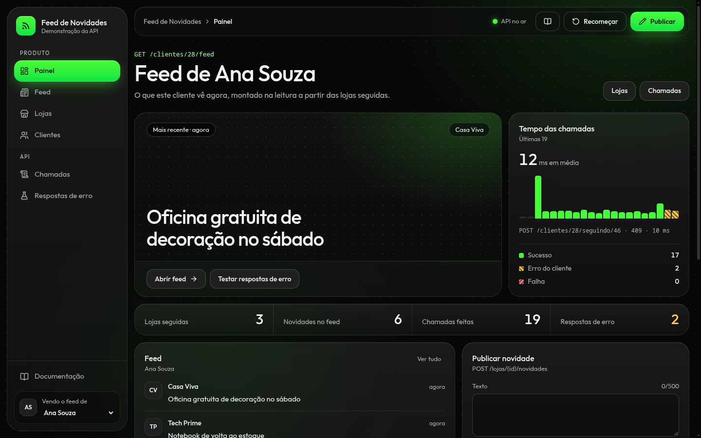
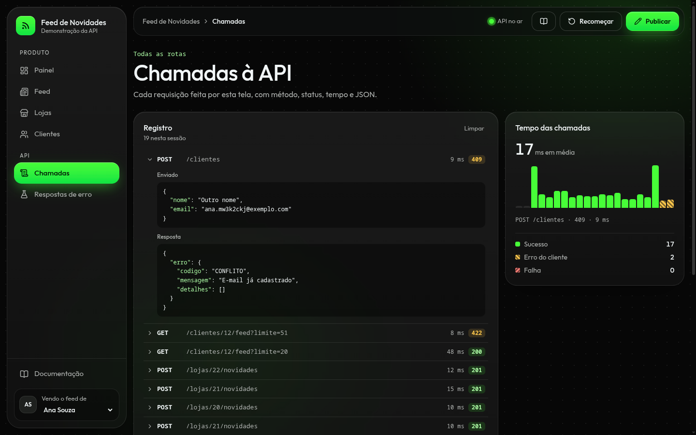

# Feed de Novidades

API REST em que clientes seguem lojas e acompanham, num feed, as novidades que essas lojas publicam.

O projeto tem a API, que é a entrega principal, e uma interface opcional para ver tudo funcionando.

| O que                          | Endereço                              |
| ------------------------------ | ------------------------------------- |
| Interface de demonstração      | `http://localhost:5173`               |
| API                            | `http://localhost:3000`               |
| Documentação interativa da API | `http://localhost:3000/documentation` |

Tudo sobe com um só comando, `npm run dev`.



## Como rodar

Pré-requisitos: Node.js 22.12 ou superior e Docker com Compose.

```bash
cp .env.example .env
docker compose up -d
npm ci
npm run dev
```

O `npm run dev` sobe a API e a interface, instala o que faltar na interface, abre o navegador e mostra os endereços no terminal. As migrations são aplicadas sozinhas ao iniciar. `Ctrl+C` encerra tudo.

Para subir só a API, use `npm run dev:api`. A especificação OpenAPI fica em `/documentation/json`.

Para ter dados de exemplo, rode `npm run seed` em outro terminal. O comando **apaga os dados do banco de desenvolvimento** e cria 5 lojas, 3 clientes e 25 novidades. O cliente 1 segue as lojas 1, 2 e 3, e o cliente 3 não segue nenhuma.

## Interface de demonstração

Uma tela para ver a API funcionando de ponta a ponta, sem nenhuma alteração na API. Ela abre sozinha com o `npm run dev`, em `http://localhost:5173`. Se essa porta estiver ocupada, o comando usa a seguinte e mostra o endereço no terminal.

### Primeiro uso

1. Clique em **Preparar cenário**. A tela cria 4 lojas, 2 clientes e 7 novidades, tudo por chamadas reais à API, e passa a mostrar o feed de Ana Souza, que segue 3 das lojas.
2. No **Painel**, publique uma novidade em uma loja seguida. Ela aparece no topo do feed.
3. Escolha **Pet Feliz**, a loja que Ana não segue, e publique de novo. A tela avisa que o feed não muda.
4. Em **Feed**, clique em **Seguir** nessa loja. As novidades dela entram no feed na hora. Clique de novo para deixar de seguir.
5. Em **Respostas de erro**, dispare um caso e veja o corpo devolvido pela API.
6. Em **Chamadas**, confira tudo o que foi feito.

### Páginas

| Página                | Para que serve                                                                     | Rotas usadas                                                                                    |
| --------------------- | ---------------------------------------------------------------------------------- | ----------------------------------------------------------------------------------------------- |
| **Painel**            | Novidade mais recente, indicadores, tempo das chamadas, feed resumido e publicação | várias                                                                                          |
| **Feed**              | Feed completo, com escolha do limite (5, 20 ou 50) e **Carregar mais**             | `GET /clientes/{id}/feed`                                                                       |
| **Lojas**             | Criar loja, seguir, deixar de seguir e publicar                                    | `POST /lojas`, `POST` e `DELETE /clientes/{id}/seguindo/{lojaId}`, `POST /lojas/{id}/novidades` |
| **Clientes**          | Criar cliente e escolher de quem é o feed exibido                                  | `POST /clientes`                                                                                |
| **Chamadas**          | Cada requisição feita pela tela, com método, status, tempo e JSON                  | todas                                                                                           |
| **Respostas de erro** | Dispara os casos 400, 404, 409 e 422 e mostra a resposta                           | várias                                                                                          |

O seletor **Vendo o feed de**, na barra lateral, troca o cliente ativo. No celular, essa troca fica na página **Clientes**.



### O que saber antes de usar

- **Os dados do `npm run seed` não aparecem na tela.** A API não tem endpoints de listagem, então a interface só conhece o que ela mesma criou, e guarda esses ids no navegador. Use **Preparar cenário**.
- **Depois de rodar o `npm run seed`, prepare o cenário de novo.** O seed apaga o banco. A tela percebe, avisa e limpa os dados locais.
- **Recomeçar** limpa só o que está no navegador. Os dados continuam no banco.
- **A faixa "A API não respondeu"** significa que a API não está rodando. Suba com `npm run dev`.
- **Se o terminal avisar que a API não respondeu,** o banco provavelmente está desligado. Rode `docker compose up -d` e reinicie o `npm run dev`.
- **Se as chamadas responderem 404 sem corpo,** o proxy do Vite pode ter ficado sem conexão com a API. Pare e rode `npm run dev` de novo.

## Como rodar os testes

Com o banco no ar (`docker compose up -d`):

```bash
npm test
```

Os testes são de integração contra PostgreSQL real, num banco `feed_novidades_test` criado automaticamente, sem tocar nos dados de desenvolvimento. Também há `npm run lint`, `npm run typecheck` e `npm run build`.

## Endpoints

O arquivo [`requests.http`](requests.http) tem todas as chamadas, inclusive de erro, prontas para rodar no VS Code (extensão REST Client) ou nas IDEs JetBrains. Os exemplos abaixo consideram o banco recém populado pelo seed e chamadas feitas nesta ordem.

### `POST /lojas`

```bash
curl -X POST localhost:3000/lojas -H 'Content-Type: application/json' \
  -d '{"nome":"Loja Azul"}'
```

`201`: `{"id":6,"nome":"Loja Azul","criadoEm":"2026-11-04T23:39:45.959Z"}`

### `POST /clientes`

```bash
curl -X POST localhost:3000/clientes -H 'Content-Type: application/json' \
  -d '{"nome":"Dani Rocha","email":"dani@exemplo.com"}'
```

`201`: `{"id":4,"nome":"Dani Rocha","email":"dani@exemplo.com","criadoEm":"2026-11-04T23:39:46.018Z"}`

### `POST /clientes/{id}/seguindo/{lojaId}`

```bash
curl -X POST localhost:3000/clientes/3/seguindo/5
```

`201`: `{"clienteId":3,"lojaId":5,"criadoEm":"2026-11-04T23:39:46.039Z"}`

### `POST /lojas/{id}/novidades`

```bash
curl -X POST localhost:3000/lojas/5/novidades -H 'Content-Type: application/json' \
  -d '{"texto":"Ração em promoção","preco":79.9}'
```

`201`: `{"id":26,"lojaId":5,"texto":"Ração em promoção","preco":"79.90","criadoEm":"2026-11-04T23:39:46.062Z"}`

### `GET /clientes/{id}/feed?limite=20`

```bash
curl 'localhost:3000/clientes/3/feed?limite=1'
```

`200`:

```json
{
  "novidades": [
    {
      "id": 26,
      "texto": "Ração em promoção",
      "preco": "79.90",
      "criadoEm": "2026-11-04T23:39:46.062Z",
      "loja": { "id": 5, "nome": "Pet Feliz" }
    }
  ],
  "proximoCursor": 26
}
```

Para a próxima página, envie o valor recebido em `cursor`. Quando `proximoCursor` vier `null`, não há mais novidades.

```bash
curl 'localhost:3000/clientes/3/feed?limite=1&cursor=26'
```

### `DELETE /clientes/{id}/seguindo/{lojaId}`

```bash
curl -X DELETE localhost:3000/clientes/3/seguindo/5
```

`204`, sem corpo. Retorna 404 se o cliente não segue a loja, inclusive ao repetir a chamada, para o mesmo tratamento valer quando o cliente ou a loja não existem.

### Erros

Toda resposta de erro tem o mesmo formato, inclusive rota inexistente e JSON malformado:

```json
{
  "erro": {
    "codigo": "VALIDACAO",
    "mensagem": "Dados inválidos",
    "detalhes": [{ "campo": "limite", "mensagem": "Deve ser no máximo 50" }]
  }
}
```

| Status | Código                                  | Quando                                       |
| ------ | --------------------------------------- | -------------------------------------------- |
| 400    | `REQUISICAO_INVALIDA`                   | JSON malformado                              |
| 404    | `NAO_ENCONTRADO`, `ROTA_NAO_ENCONTRADA` | Recurso ou rota inexistente                  |
| 409    | `CONFLITO`                              | E-mail repetido ou loja já seguida           |
| 413    | `CORPO_MUITO_GRANDE`                    | Corpo acima de 1 MB                          |
| 415    | `TIPO_NAO_SUPORTADO`                    | Content-Type diferente de JSON               |
| 422    | `VALIDACAO`                             | Valor inválido no corpo, na rota ou na query |
| 500    | `ERRO_INTERNO`                          | Falha inesperada, sem expor detalhes         |

## Estrutura de pastas

```
src/
  app.ts       monta o Fastify, usado pelo servidor e pelos testes
  server.ts    aplica as migrations e sobe o servidor
  env.ts       valida as variáveis de ambiente
  db/          conexão, schema, migrations, seed e tradução de restrições
  http/        formato de erro e schemas compartilhados
  modulos/     lojas, clientes e feed, cada um com rotas.ts e servico.ts
drizzle/       migrations SQL versionadas
test/          testes de integração e helpers
web/           interface de demonstração em React
scripts/       comando que sobe a API e a interface juntas
docs/          imagens usadas neste README
.github/       workflow de CI
```

Rotas cuidam de HTTP e validação. Serviços cuidam das regras e do banco. Seguir fica em `clientes` e publicar fica em `lojas`, acompanhando o prefixo da rota.

## Decisões técnicas

### O feed é montado na leitura

Como o cliente lê muito mais do que a loja publica, a primeira ideia é pré-calcular o feed, copiando cada novidade para uma tabela por seguidor. Descartei porque uma loja com 100 mil seguidores transformaria cada publicação em 100 mil inserts, exigindo fila, e seguir uma loja exigiria preencher o feed retroativamente.

O que pesa na leitura é quantas lojas o cliente segue, e esse número é pequeno. Quantos seguidores a loja tem não entra na conta. Por isso a consulta usa `LATERAL` para ler só as novidades mais recentes de cada loja seguida pelo índice `(loja_id, criado_em DESC, id DESC)`, ordena esse conjunto e corta no limite. A loja só é buscada depois do corte.

Medições num notebook, com PostgreSQL 17 em Docker, 2 mil lojas, 150 mil clientes, 4,5 milhões de relações de seguir e 3 milhões de novidades, sendo uma das lojas com 100 mil seguidores. O feed foi medido com 100 execuções do serviço, com `limite=20`:

| Cenário                                                                           | Resultado                                    |
| --------------------------------------------------------------------------------- | -------------------------------------------- |
| Feed de cliente que segue 31 lojas                                                | 5 ms (mediana), 8 ms (p95)                   |
| Feed de cliente que segue 2 mil lojas                                             | 88 ms (mediana), 105 ms (p95)                |
| Mesmo feed de 31 lojas com `JOIN` simples, em execução única e sem cache aquecido | 170 ms, lendo 46.758 novidades em vez de 620 |
| Publicar em loja com 100 mil seguidores                                           | 4 ms                                         |
| Copiar uma novidade para 100 mil feeds, em execução única                         | 377 ms por publicação                        |

### Banco

- **Regras no banco:** e-mail único, chave primária `(cliente_id, loja_id)`, chaves estrangeiras e `CHECK` de texto e preço. Os erros 404 e 409 de seguir e publicar vêm dessas restrições, sem `SELECT` prévio, porque duas requisições simultâneas passariam juntas por uma checagem na aplicação. Há teste com requisições em paralelo.
- **`seguindo` sem índice extra:** a chave primária já começa por `cliente_id`, que é a busca do feed. Um índice por `loja_id` só faria sentido com uma funcionalidade que liste seguidores.
- **`bigint` como id:** índice compacto e ids fáceis de usar em testes manuais. Em troca, os ids são sequenciais e revelam volume, o que seria reavaliado se a API fosse pública.
- **`NUMERIC(12,2)` para preço:** float acumula erro de arredondamento em dinheiro.

### Comportamento da API

Pontos que o enunciado deixa abertos:

- **`limite` fora da faixa retorna 422**, em vez de reduzir para 50. Assim quem chama nunca recebe menos do que pediu sem saber.
- **`preco` entra como número e sai como string** (`"19.90"`), para não passar por float em quem consome. Mais de 2 casas decimais é rejeitado, em vez de arredondado.
- **Novidades anteriores ao seguir aparecem no feed**, porque o enunciado fala em tudo o que as lojas publicaram.
- **`texto` conta caracteres reais:** `String.length` contaria um emoji como 2, e 500 emojis seriam rejeitados, enquanto o `char_length` do banco os aceita.
- **`texto` e `nome` são gravados sem espaços nas pontas**, e só espaços conta como vazio.
- **`email` é gravado em minúsculas**, para `A@x.com` e `a@x.com` serem o mesmo cliente.
- **Empate de horário é resolvido pelo `id`**, para a ordem ser estável entre chamadas.

### Paginação por cursor

O `cursor` é o id da última novidade recebida, e a consulta continua a partir de `(criado_em, id)` dela. Com `OFFSET`, o banco leria e descartaria tudo o que foi pulado, e cada novidade publicada durante a navegação deslocaria as páginas, repetindo itens. Com cursor, o custo não depende da profundidade: medi 3,0 ms na primeira página e 3,3 ms perto do fim de 3 milhões de novidades.

O horário do cursor é lido do banco como texto porque o PostgreSQL guarda microssegundos e o `Date` do JavaScript só guarda milissegundos, o que pularia novidades do mesmo milissegundo. Há teste para esse caso. O `proximoCursor` vem de buscar um item além do limite, o que dispensa contagem.

### Organização e bibliotecas

- **Sem camada de repositório:** com cinco endpoints ela só repassaria chamadas. As consultas ficam nos serviços.
- **Fastify:** valida por schema nativamente e tem `inject`, que testa a API sem abrir porta.
- **Zod com `fastify-type-provider-zod`:** o mesmo schema valida a entrada e gera os tipos, sem duplicar definições.
- **Drizzle:** schema tipado e migrations em SQL legível, com pouca abstração. O `LATERAL` é suportado pelo construtor de consultas, então o feed não precisou de SQL solto nem de mapeamento manual.
- **Vitest contra PostgreSQL real:** as regras principais dependem de restrições e da ordenação do banco, que um mock não verificaria.
- **Biome:** lint e formatação numa só ferramenta.
- **OpenAPI gerada dos schemas Zod:** a documentação usa os mesmos schemas que validam entrada e saída, então não tem como divergir do comportamento real.
- **Interface em `web/`, separada da API:** projeto próprio, com dependências próprias, ligado à API pelo proxy do Vite. A API não sabe que ela existe, e nenhuma linha do backend mudou para recebê-la. Como a API não tem endpoints de listagem, que o enunciado não pede, os ids criados ficam no `localStorage`, e a tela se recupera sozinha se o banco tiver sido reiniciado.
- **GitHub Actions:** lint, tipos, build e testes a cada PR, em Node 22.12, a versão mínima, e 26.

## O que ficou de fora e o que faria com mais tempo

Os quatro diferenciais do enunciado foram feitos: deixar de seguir, paginação por cursor, OpenAPI e CI. Também incluí encerramento gracioso, para um deploy não interromper requisições em andamento: ao receber `SIGTERM`, a API termina o que está atendendo e fecha a conexão com o banco.

Limites conhecidos e próximos passos:

- **Cliente que segue muitas lojas:** o custo cresce com esse número, como mostra a medição de 88 ms. Se isso virar um caso real, os caminhos são um limite de lojas seguidas ou um cache curto do feed.
- **Migrations ao subir a API:** simples para este projeto. Em produção com várias instâncias, eu rodaria como etapa do deploy.
- **Tamanho de `nome`:** o enunciado não define máximo, e o único teto hoje é o limite de 1 MB do corpo.
- **Testes da interface:** o CI só garante que ela compila. O comportamento foi verificado manualmente no navegador.
- **Observabilidade e proteção:** métricas, rate limit e autenticação, esta última fora do escopo do desafio.
